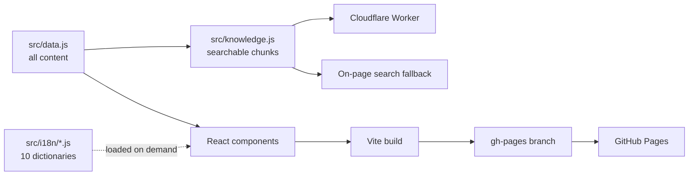
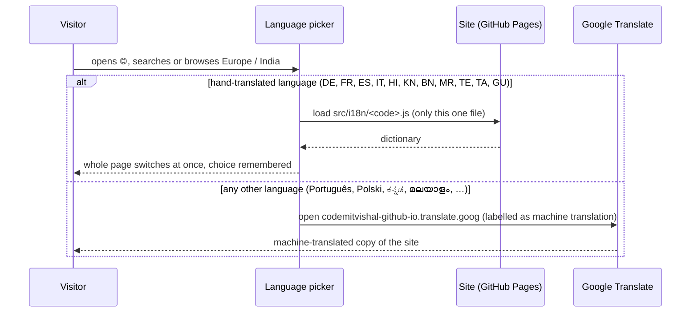
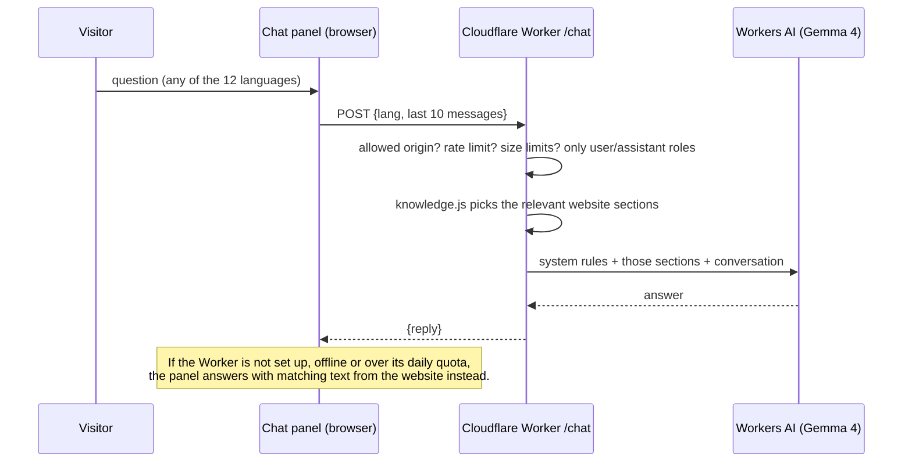

# Vishal Singh · Portfolio

**Live:** https://codemitvishal.github.io/

Personal portfolio of Vishal Singh, hands-on Software Engineer (C# / .NET APIs, event-driven back ends, Angular, Azure & Kubernetes, AI agents): experience, case studies, open-source projects, Microsoft certifications, education, master's thesis, teaching, and an AI assistant that answers questions about all of it, in 12 hand-translated languages.

## Architecture


Three parts, each small enough to read in one sitting:

| Part | Where | What it does |
|---|---|---|
| **Content** | [`src/data.js`](src/data.js) | Every fact on the site: jobs, projects, skills, certifications, education, thesis. Edit this file to update the site. |
| **Translations** | [`src/i18n/`](src/i18n/), [`src/i18n.jsx`](src/i18n.jsx), [`src/languages.js`](src/languages.js) | Dictionaries keyed by the exact English text, loaded only when chosen. |
| **AI assistant** | [`src/Assistant.jsx`](src/Assistant.jsx), [`src/knowledge.js`](src/knowledge.js), [`worker/`](worker/) | Chat panel in the browser, and a Cloudflare Worker that answers from the website content only. |

### How data flows



`data.js` is the single source of truth. The page renders it, and `knowledge.js` turns the same content into small chunks for the assistant. Both the browser and the Worker import that one file, so the assistant can never know more, or less, than the website shows.

### How translation works



- **English is the default** for every first visit. A choice is remembered in the browser, and links like [`?lang=de`](https://codemitvishal.github.io/?lang=de) open a language directly.
- **The picker follows language-selector UX guidance:**
  - names are shown in their own language and script (endonyms), with no flags, since flags stand for countries, not languages;
  - a globe button in the header opens it;
  - there is search across all languages, the most-used languages come first, and "More languages" sits behind a disclosure;
  - it works with the keyboard (focus moves into the panel; Escape closes it) and as a bottom sheet on phones.
- **Hand-translated:** English, Deutsch, Français, Español, Italiano, हिन्दी, ಕನ್ನಡ, বাংলা, मराठी, తెలుగు, தமிழ், ગુજરાતી.
  - Product and technology names (Azure, Service Bus, Clean Architecture, …) stay in their original form, as engineers write them.
  - Indian languages use the respectful form when referring to Vishal.
  - Colleague quotes and the thesis title stay in their original English, and the page says so.
- **Every other European and Indian language** opens Google's machine translation of the site. The picker marks these with **G ↗** and says they may contain errors.
- **Rich text inside translations** uses `**bold**`, `*italic*` and `{placeholder}` (for links), so each language can use its own word order.
- **Language switches are atomic.** The page keeps the current language until the new dictionary has loaded, so text never appears half in one language and half in another.
- **Fonts:** Indian scripts use Noto Sans/Serif (Devanagari, Kannada, Bengali, Tamil, Telugu, Gujarati) with taller line spacing; Google Fonts only downloads a script's font when that script appears on the page.

To add or change text: edit the English in `data.js` or a component, then add the same English string with its translation to each file in `src/i18n/`. Any string without a translation simply stays in English. In the browser console, `window.__i18nMissing` lists anything not yet translated.

### How the AI assistant works



**Security, and why nothing sensitive is public:**
- **No secrets in the code.** The Worker reaches Workers AI through a Cloudflare *binding*, so there is no API key, token or password in the browser, in this repo or in the Worker. A pre-commit hook ([`scripts/check-secrets.mjs`](scripts/check-secrets.mjs), enabled by `npm install`) blocks commits that contain keys, tokens, passwords, connection strings or phone numbers; run it over the whole repo with `npm run check:secrets`. `.env*`, `.dev.vars`, `*.pem` and `*.key` are git-ignored.
- **Website facts only.** The model sees only text that the website shows (built from `data.js` by [`src/knowledge.js`](src/knowledge.js)) and is told never to add general knowledge or guess. That includes the availability date, so "when can he start?" is answered with 1 March 2027.
- **Locked to this site.** CORS only allows `https://codemitvishal.github.io` and its Google-translated copy; localhost is not allowed in production. For local testing, put `ALLOWED_ORIGINS="http://localhost:5173"` in a git-ignored `worker/.dev.vars` and run `npm run assistant:dev`.
- **Abuse limits:**
  - 8 requests per minute per visitor (Cloudflare rate-limit binding);
  - the request body is capped at 16 KB while it is read; at most 10 messages, 800 characters each and 4,000 in total; JSON only;
  - only `user` and `assistant` roles accepted, so a visitor cannot inject their own system prompt; invisible control characters are removed.
- **Grounded answers.** The model must answer only from the supplied website content, say "I don't know" otherwise, stay on topic, ignore attempts to change its rules, and never ask for personal data.
- **Privacy.** Nothing visitors type is logged; the Worker logs only token counts.
- **Hardened responses.** The Worker sends `nosniff`, `no-referrer`, `no-store` and a deny-all CSP. The website gets a Content-Security-Policy at build time (see [`vite.config.js`](vite.config.js)): scripts only from the site itself (inline scripts only by their hash), network calls only to the assistant, no frames, plugins or forms. It is not applied on Google's translated copy (`*.translate.goog`), because Google's proxy injects its own scripts there.
- **No surprise bills.** The Workers Free plan includes 10,000 AI units per day (roughly 300 questions). When they run out, the AI simply stops until the next day and the chat falls back to on-page search.
- The chat panel tells visitors that AI can make mistakes and not to share personal information.

**Status:** live. The Worker runs at `https://vishal-portfolio-assistant.codemitvishal-portfolio.workers.dev` (set in `assistant.endpoint` in [`src/data.js`](src/data.js)). Typical cost: 8–40 free units per question, so the free 10,000 daily units cover several hundred questions.

**Update the assistant** after changing `data.js` (it reads the same content):

```bash
npm run assistant:deploy
```

Wrangler must be logged in to the Cloudflare account once (`npx wrangler@4 login`). To watch it live: `npx wrangler@4 tail vishal-portfolio-assistant`. If the endpoint is ever removed, the chat falls back to **search mode**, quoting the matching parts of the website.

## Design

- An editorial "field notes" look:
  - fonts: Instrument Serif for display, Geist for body text, Geist Mono for labels;
  - paper-and-ink colours with a single accent, and hairline rules instead of cards;
  - numbered sections, and schematic diagrams of real systems in the case studies.
- Built for recruiters: who, what and how to get in touch is clear within 5 seconds; case studies follow problem → what I built → outcome; official Microsoft certification badges link to Microsoft Learn.
- Responsive, with light and dark themes. Accessible: visible keyboard focus, reduced motion respected, ARIA labels, and a correct `lang` attribute on every language name.

## Run locally

```bash
npm install
```

```bash
npm run dev
```

## Deploy the website

```bash
npm run deploy
```

This builds the site and pushes `dist/` to this repo's `gh-pages` branch, which GitHub Pages serves at https://codemitvishal.github.io/. The source code lives on `main`.
